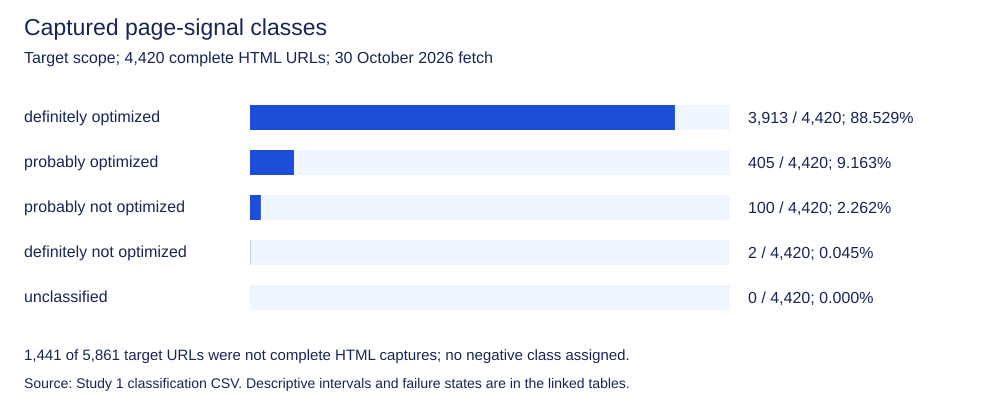

# Optimization signals are common in captured AI-cited pages

**Among 4,420 successfully fetched target URLs, 3,913 met the registered “definitely optimized” rule: 88.5%, Wilson 95% interval 87.6% to 89.4% (Broadcastwell, Study 1).**

The comparison starts with **different populations, dates and rules**. Lewandowski and colleagues studied German Google result sets collected in 2020. We examined URLs cited in archived B2B software answers from September 2026, then fetched their pages on 30 October. Our static-page signature rules adapt and expand the original approach. These differences precede any comparison of percentages.

The finding is descriptive: optimization-associated signatures are common among the pages we could capture. It does not show that adding those signatures caused the original citations, or that the captured page was unchanged since the answer. [Registered Study 1](https://doi.org/10.17605/OSF.IO/DVYFU); [complete method and files](../../studies/optimized-pages-in-ai-answers/).

## What did the earlier Google study find?

Figure 1 in the original ACM article groups **256,853 result URLs** into **59.0% definitely optimized**, **29.0% probably optimized** and **12.0% (probably) not optimized**. Those are the chart’s combined result figures, with the authors’ certainty labels retained. The chart is on printed page 17, PDF page 6. [Lewandowski et al., 2021, Figure 1](https://searchstudies.org/wp-content/uploads/2021/08/3447535.3462479.pdf).

The paper’s classes are inferred from observable features. Publisher intent was not surveyed. Calling the combined positive groups simply “optimized” would erase the uncertainty the authors preserved.

Nor should the prose’s **48.4%, 27% and 31%** be substituted for the chart. Those are **news-content shares**. They refer to the Google Trends, radical-right and coronavirus datasets. They explain a difference in source composition; they are not a conflicting set of optimization-class percentages. [Original §5, same PDF page].

The original article provides a historical way to ask which visible features result pages carry. It does not establish a universal recipe for appearing in every search system. Our question transfers the descriptive idea to an archived citation set while keeping the changed design explicit.

## What did we actually capture?

The eligible archive supplies **6,271 distinct exact citation URLs across target and control answers**, mapping to **6,261 fragment-free requested resources**. Distinct exact URLs remain the analysis unit; removing a fragment for a request does not merge the original identifiers in the classification tables.

For target questions, **4,420 of 5,861 distinct URLs** produced complete successful HTML captures: **75.4%, Wilson 95% interval 74.3% to 76.5%**. The remaining **1,441** are retrieval failures or other noneligible page captures. They receive no negative optimization classification. [Study 1 fetch-outcome and classification CSVs](../../studies/optimized-pages-in-ai-answers/).

This denominator is central to the result. A page blocked by robots policy, an access restriction or a timeout may be optimized or unoptimized; this collection cannot tell. Restricting the class-share table to captured HTML does not make the missing pages a random sample.

## Which signals place a page in each class?

For successful HTML, the registered precedence first treats Wikipedia and its specified sister projects as definitely not optimized. This is a stipulated comparison category, not a judgment about the quality of those sites.

Other pages enter the definitely optimized class if they show a listed SEO-plugin signature, qualifying structured data, the frozen news-domain indicator or a listed advertising signature. The structured-data rule is broad: qualifying JSON-LD or microdata can count regardless of whether a publisher installed it specifically to improve search visibility.

If none of those strong indicators applies, a missing nonempty title or description leads to probably not optimized. That rule overrides weak positive signals. Otherwise a weak indicator, such as HTTPS, canonical markup, viewport, Open Graph, a qualifying host file or a short time to first byte, leads to probably optimized. A residual page remains unclassified.

In other words, the class name abbreviates a declared rule. It should not be expanded into a claim that we verified a publisher’s optimization intent. [Frozen rules and registered precedence](../../data/study1-registered-plan.txt).

## What are the target-page results?



| Registered class | Count / successful HTML base | Share (Wilson 95% interval) |
| --- | --- | --- |
| definitely optimized | 3,913 / 4,420 | 88.5% (87.6% to 89.4%) |
| probably optimized | 405 / 4,420 | 9.2% (8.3% to 10.0%) |
| probably not optimized | 100 / 4,420 | 2.3% (1.9% to 2.7%) |
| definitely not optimized | 2 / 4,420 | 0.045% (0.012% to 0.165%) |
| unclassified | 0 / 4,420 | 0.000% (0.000% to 0.087%) |

Source: [class-share CSV](../../data/study1-class-shares.csv), target scope, all engines and categories. The table’s denominator includes unclassified successful HTML. Its intervals are descriptive Wilson intervals conditional on this archive; URL and repeated-answer dependencies prevent a representative population interpretation.

The large definite class follows the broad registered signature rule. It is not evidence that the proportion of optimized sites increased from the historical Google study by the difference between the two headline percentages. Neither sample, measurement date nor classification implementation is held constant.

## What does the result look like by engine?

| Engine | Definitely optimized / successful HTML URLs | Share (Wilson 95% interval) |
| --- | --- | --- |
| ChatGPT | 577 / 825 | 69.9% (66.7% to 73.0%) |
| Claude | 1,148 / 1,228 | 93.5% (92.0% to 94.7%) |
| Google AI Mode | 599 / 663 | 90.3% (87.9% to 92.4%) |
| Google AI Overviews | 1,066 / 1,168 | 91.3% (89.5% to 92.8%) |
| Perplexity | 1,656 / 1,766 | 93.8% (92.5% to 94.8%) |

Each row counts distinct exact target URLs cited by that engine and successfully captured later. A URL cited by several engines contributes to several rows, so these are overlapping strata. The [full download](../../data/study1-class-shares.csv) gives every class and interval for every engine, category and joint stratum, including controls separately.

An engine row is not a citation probability for pages with a given feature. We selected pages because their URLs were already cited. We did not collect a comparable pool of uncited eligible pages or assign page changes experimentally. The table answers what the captured cited pages carried, not how much a signature improved their chance of citation.

## What should a software publisher do with this evidence?

Use it to avoid a false dichotomy between useful pages and technically legible pages. Product identity, readable content and truthful structured descriptions can coexist. The observation does not require choosing between reader usefulness and basic technical hygiene.

It also gives no reason to manufacture metadata or install a plugin solely to enter a research class. A signature can be common because publishing systems supply it by default. Its prevalence within cited pages is insufficient to establish an advantage over pages without it.

For a proposed change, identify the actual problem it addresses. A missing description, broken response or ambiguous product claim can be assessed on its own terms. A claim of increased AI citation requires an outcome design that goes beyond counting signals after citation has already occurred.

## Which limits matter most?

The pages were fetched after the archived answers. Static HTML misses material that requires script execution, and the signature list cannot identify every analytics, advertising or optimization implementation. The news list is conservative and frozen, rather than an exhaustive classification of publishers.

The time-to-first-byte threshold is our adaptation of the paper’s page-loading-time feature. Those are different measurements. The expanded structured-data rule and registered precedence likewise differ from the original paper’s fitted classification procedure.

Finally, this is a fixed software-question archive, not a probability sample of buyer searches or all cited web pages. Report the count, base, dates and class definition together. Those details are the finding’s boundaries, rather than fine print to discard when quoting it.

Lewandowski, Sünkler and Yagci write that “a large fraction of pages found in Google is at least probably optimized”. Their wording preserves the probable class instead of treating every inferred feature as confirmed publisher intent. [Lewandowski et al., 2021, abstract, PDF p. 1; doi:10.1145/3447535.3462479].

You can inspect the class rules before comparing percentages.

## What our own data shows

Source archive: [release 2026-09, DOI 10.5281/zenodo.22907695](https://doi.org/10.5281/zenodo.22907695).

Registered Study 1 classifies **3,913/4,420 captured target URLs as definitely optimized: 88.5%, Wilson 95% interval 87.6% to 89.4%**. Separately, complete HTML retrieval succeeded for **4,420/5,861 target URLs: 75.4% (74.3% to 76.5%)**. Missing captures remain outside the class denominator.

The [complete study](../../studies/optimized-pages-in-ai-answers/) publishes the scalar observations, classification and membership tables, failures, chronology, frozen rules and reproduction programs. We have no causal measurement of the citation benefit of these signals.

## Sources

- Lewandowski, D., Sünkler, S., & Yagci, N. (2021). The influence of search engine optimization on Google’s results: A multi-dimensional approach for detecting SEO. WebSci 2021 (pp. 12 to 20). ACM. Figure 1, printed p. 17 (PDF p. 6); feature and classification method, §§3 to 4. doi:10.1145/3447535.3462479 . Accessible author original: https://searchstudies.org/wp-content/uploads/2021/08/3447535.3462479.pdf Verified 30 October 2026.
- Broadcastwell. (2026). Study 1 plan: Do AI engines cite optimized pages? [Registration]. OSF. Registered 30 October 2026, 01:06:12 UTC; public approval completed before this study’s collection and aggregation. https://doi.org/10.17605/OSF.IO/DVYFU Verified 30 October 2026.
- Broadcastwell. (2026). Absence Index, release 2026-09 [Data set]. Zenodo. Release JSON, answer JSONL and README. https://doi.org/10.5281/zenodo.22907695 Verified 30 October 2026.

## Cite this page

Broadcastwell research team. (2026, October 30). *Optimization signals are common in captured AI-cited pages*. Broadcastwell. https://docs.broadcastwell.com/research/insights/nearly-every-google-result-is-optimized/ Published 30 October 2026; updated 30 October 2026.

```bibtex
@online{broadcastwell2026research2,
  author = {{Broadcastwell research team}},
  title = {Optimization signals are common in captured AI-cited pages},
  year = {2026},
  date = {2026-10-30},
  url = {https://docs.broadcastwell.com/research/insights/nearly-every-google-result-is-optimized/},
  urldate = {2026-10-30},
  note = {Published 2026-10-30; updated 2026-10-30}
}
```

Prepared by the Broadcastwell research team. Lead: Priya Nair, management consultant.

Sources checked 30 October 2026. Independent check: 30 October 2026, Broadcastwell verification desk. This page has not been peer reviewed.

Last updated: 30 October 2026. Next review: 30 January 2027.

## Continue

- [Run a free visibility check](https://audit.broadcastwell.com/).
- [Read the rules for a valid comparison](https://docs.broadcastwell.com/valid-measurement/).
