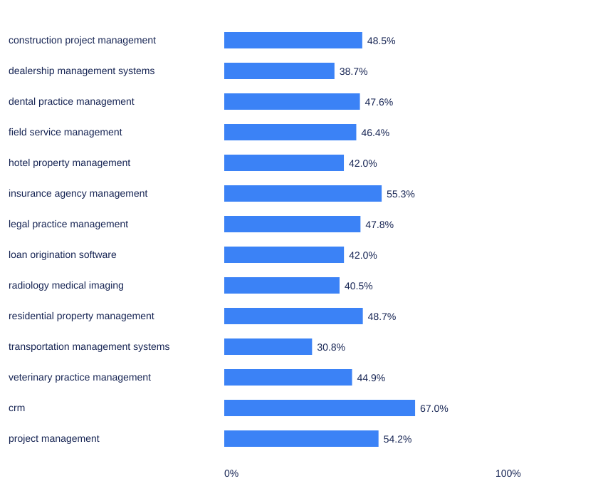

# Concentrated visibility is a reason to inspect the denominator

**CRM’s leading three vendors account for 319/476 naming occurrences: 67.0%, Wilson 95% interval 62.7% to 71.1% (Broadcastwell, 2026, September counts).**

In September’s CRM answers, the leading three checked vendors account for **319 of 476 checked-vendor naming occurrences**, **67.0%**, descriptive **95% Wilson interval 62.7% to 71.1%**. That concentration is a property of names in the captured answers, not the share of buyers reached through an acquisition channel. [Broadcastwell, release 2026-09, CRM vendor counts](https://doi.org/10.5281/zenodo.22907695).

It is tempting to turn a concentrated table into a business-risk headline. Before doing so, ask what the denominator contains. Vendor names, source references, website visits and revenue can all be concentrated for different reasons. None becomes a substitute for the others merely because each can be expressed as a percentage.

## The historical traffic example contains two different percentages

Meslem and Abbaci’s small Algerian e-commerce study uses nonparticipant observation and Similarweb estimates. In its Jumia DZ row, it reports **99.24%** for natural search optimization and separately states that organic search accounts for **58.10% of site traffic**. Reporting the first figure as the share of every visit would erase the distinction printed in the same row. [Meslem and Abbaci, 2024, Table 2, printed p. 61; PDF p. 84](https://doi.org/10.1007/978-3-031-51038-0_7).

The Yassir row calls its approach **100% SEO**, but does not supply the underlying traffic counts or a sufficiently explicit denominator to convert that wording into an audited channel-dependency rate. The chapter describes a March to May 2023 period for the accompanying traffic observations. These are historical estimates and qualitative case descriptions, not a current statement about either business. [Table 1, printed p. 60; PDF p. 83].

We therefore do not recommend either percentage as a universal warning threshold. The authors themselves say further work could “assess their impact on actual market performance.” Their recommendations are not a measured comparison of diversified and undiversified businesses. [Meslem and Abbaci, §4, printed p. 62].

That limitation does not make channel planning unimportant. It means the practical judgment needs the company’s own exposure and economics. An AI-answer naming table supplies one observation to that investigation. It cannot reveal what happens to sales if one source of discovery disappears.

## How concentrated are the checked names in each category?

For each category, we sum the deposited named counts for the checked vendors, order the vendors by that count and divide the leading three vendors’ total by the category’s total checked-vendor naming occurrences. Alphabetical name order resolves ties. Each valid answer can name several vendors, so the denominator is larger than the answer count and has a different meaning.



| Category | Leading three checked vendors | Their naming occurrences / all checked-vendor naming occurrences | Share and descriptive 95% Wilson interval |
|---|---|---:|---|
| construction project management | Procore, Buildertrend, Contractor Foreman | 269 / 555 | 48.5% (44.3% to 52.6%) |
| dealership management systems | CDK Global, DealerCenter, Tekion | 245 / 633 | 38.7% (35.0% to 42.6%) |
| dental practice management | Dentrix, Open Dental, Curve Dental | 353 / 741 | 47.6% (44.1% to 51.2%) |
| field service management | Housecall Pro, ServiceTitan, Workiz | 268 / 578 | 46.4% (42.3% to 50.4%) |
| hotel property management | Cloudbeds, Stayntouch, Little Hotelier | 234 / 557 | 42.0% (38.0% to 46.2%) |
| insurance agency management | Applied Systems, EZLynx, HawkSoft | 335 / 606 | 55.3% (51.3% to 59.2%) |
| legal practice management | Clio, 8am MyCase, CosmoLex | 299 / 625 | 47.8% (43.9% to 51.8%) |
| loan origination software | nCino, MeridianLink, ICE Mortgage Technology | 235 / 559 | 42.0% (38.0% to 46.2%) |
| radiology medical imaging | Sectra, Intelerad, Visage Imaging | 232 / 573 | 40.5% (36.5% to 44.6%) |
| residential property management | Buildium, AppFolio, DoorLoop | 291 / 598 | 48.7% (44.7% to 52.7%) |
| transportation management systems | AscendTMS, Alvys, Oracle Transportation Management | 165 / 535 | 30.8% (27.1% to 34.9%) |
| veterinary practice management | ezyVet, IDEXX (Cornerstone, Neo), Digitail | 272 / 606 | 44.9% (41.0% to 48.9%) |
| crm | HubSpot CRM, Salesforce Sales Cloud, Pipedrive | 319 / 476 | 67.0% (62.7% to 71.1%) |
| project management | Asana, ClickUp, Jira | 240 / 443 | 54.2% (49.5% to 58.8%) |

Source: [release 2026-09 vendor mention_rate counts](https://doi.org/10.5281/zenodo.22907695), reanalysis dated 30 October 2026. [Full CSV, including each engine separately](../../data/vendor-concentration.csv). Intervals describe these occurrence proportions; shared answers and questions mean they are not independent population trials. No category is being declared statistically more concentrated than another.

## The checked set defines the result

The Index checks a published vendor set for each category. If an answer names a product outside that set, it does not enter this denominator. Adding vendors could therefore change the concentration figure even if none of the saved answers changed. The figure is not the share of every software name an engine could produce.

The leading vendors are also selected from the same observations used to calculate the share. The intervals do not account for uncertainty in that selection. They should be read as descriptive bounds around the reported proportion, not a formal confidence statement about which businesses will lead in a future run.

The five-engine aggregate weights naming occurrences. An engine that names more checked vendors can contribute more to the category total. The separate engine tables allow you to inspect that composition without mistaking an aggregate for the typical answer from a typical engine.

## A fictional planning example

Suppose a fictional scheduling supplier, Alder Desk, finds that its category’s answers repeatedly name a small group of competitors. The table can tell its team where to inspect the saved answers. It cannot tell the team that the competitors bought their visibility, that a single website explains the pattern or that the same products dominate paid demand.

The next useful record is specific: which relevant questions named Alder Desk, which did not, which sources appeared and whether the sources contained accurate product information. A missing feature description may suggest a documentation correction. It still does not prove that the omission caused an answer to exclude the supplier.

Now suppose Alder Desk already depends heavily on one acquisition source. That is a separate business observation requiring its own traffic, lead-quality and revenue evidence. Combining the two records may help prioritize an investigation. It does not justify multiplying the percentages together to manufacture a loss forecast.

## What would a stronger risk analysis need?

You would want consistent definitions across the discovery and commercial records, a relevant time window and a credible account of substitution. Buyers may move between sources; a lost visit may be replaced elsewhere; an answer may name a vendor without creating a visit at all. The saved citation or naming event does not establish those downstream paths.

Repeated measurements under the same configuration can help distinguish a persistent observation from a single run. They still do not create a causal effect of diversification. Testing a change requires a design that preserves comparability and makes alternative explanations visible.

The choice for a business is therefore narrower than “follow the biggest percentage.” Use the category table to locate concentration in the observed answers, then decide whether that observation matters alongside your own evidence. The unresolved question is how much of the commercial exposure would actually remain if a particular route to discovery changed.

## What our own data shows

In CRM, the leading three vendors account for **319/476 vendor-naming occurrences, 67.0% (Wilson 95% interval 62.7% to 71.1%)**. This is a share of naming occurrences, not buyers or market share. The chart and table are computed from the published vendor naming counts in [September release 2026-09](https://doi.org/10.5281/zenodo.22907695). The [CSV](../../data/vendor-concentration.csv) retains all 14 categories and all five engines separately. This is an additional descriptive analysis, not Study 1, and it contains no traffic or revenue observations. The [public calculation](../../data/release_descriptives.py) defines the occurrence denominator; neither the leading vendors nor the category totals are market shares.

## Sources

- Broadcastwell. (2026). Absence Index, release 2026-09 [Data set]. Zenodo. Release JSON, answer JSONL and README. https://doi.org/10.5281/zenodo.22907695 Verified 30 October 2026.
- Meslem, H., & Abbaci, A. (2024). Netnographic study on the adoption of inbound marketing by e-commerce platforms in Algeria. In Strategic innovative marketing and tourism (pp. 57 to 63). Tables 1 and 2, printed pp. 60 to 61. https://doi.org/10.1007/978-3-031-51038-0_7 Verified 30 October 2026.

## Cite this page

Broadcastwell research team. (2026, October 30). *Concentrated visibility is a reason to inspect the denominator*. Broadcastwell. https://docs.broadcastwell.com/research/insights/one-channel-is-a-risk/ Published 30 October 2026; updated 30 October 2026.

```bibtex
@online{broadcastwell2026research9,
  author = {{Broadcastwell research team}},
  title = {Concentrated visibility is a reason to inspect the denominator},
  year = {2026},
  date = {2026-10-30},
  url = {https://docs.broadcastwell.com/research/insights/one-channel-is-a-risk/},
  urldate = {2026-10-30},
  note = {Published 2026-10-30; updated 2026-10-30}
}
```

Prepared by the Broadcastwell research team. Lead: Priya Nair, management consultant.

Sources checked 30 October 2026. Independent check: 30 October 2026, Broadcastwell verification desk. This page has not been peer reviewed.

Last updated: 30 October 2026. Next review: 30 January 2027.

## Continue

- [Run a free visibility check](https://audit.broadcastwell.com/).
- [Read the measurement chapter](https://docs.broadcastwell.com/measurement-noise/).
