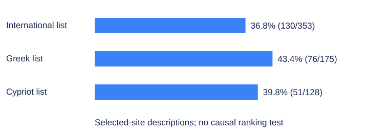

# Commenting features are not evidence of a ranking gain

**A 656-site walkthrough recorded commenting features, not ranking gains from comments (Karyotakis et al., 2019, §§3 to 4).**

The **656-site** study inspected how selected news websites allowed comments. It did not measure a change in Google rank, search visits or AI citations caused by enabling comments. [Karyotakis et al., 2019, §§3 to 4, reprint PDF pp. 91 to 95, printed pp. 82 to 86](https://doi.org/10.3390/fi11090188).

That distinction is easy to miss because the paper repeatedly connects comments with SEO. The direct observations concern available website features. The explanations of why those features might affect visibility draw on other literature and the authors’ interpretation. They are not the same kind of result.

## Where did the sites come from?

The study used Alexa lists to select an international group and groups associated with Greece and Cyprus. The final examined lists contained **353**, **175** and **128 websites**, respectively. Those counts sum to the reported 656 entries. [§3, PDF p. 91, and §4, PDF pp. 93 to 95].

The lists are not probability samples of every news publisher in those locations. The authors removed aggregators and social-media sites, encountered pages they could not access and excluded non-news entries. Their descriptions also note that a country’s popular-site list could include sites from elsewhere. The Cypriot list, for example, included Turkish news sites with Turkish- and English-language content. [§4].

For the international list, the authors began with **500** highly visited entries and retained **353** after exclusions. They specifically mention inaccessible sites, including US sites unavailable under the access conditions associated with GDPR. This is a possible selection problem: the pages that could be inspected may differ from those that could not. [§4, PDF p. 93, printed p. 84].

The article was published on **30 August 2019**. That date is not a precise collection date for every inspected site. Its methods do not provide a sufficiently detailed observation calendar to reconstruct a current feature inventory. A reader should therefore describe the results as the paper’s historical walkthrough, not as the present policy of the named publishers. [Article title page, PDF p. 88; §3].

## What did the walkthrough record?

The researchers inspected commenting options and classified the news outlets by media type. They asked whether sites let users comment through social-media accounts and whether multiple commenting platforms were available. These questions concern interface availability. [§3 and Figures 1 to 3, PDF pp. 91 to 93].

An available comment facility is not the same as an active community. It does not tell us how many people commented, whether comments were substantive, whether a moderator approved them, or whether search systems could retrieve the final text. Those outcomes would require additional observations.

Nor does a page lacking social-account login necessarily lack comments altogether. It might have its own account system or a different participation route. The wording of the feature being counted must travel with the number. A percentage about social-account commenting cannot be relabeled the percentage of sites that permit any comment.

The paper calls its procedure the “walkthrough method.” That is a useful name for inspecting available functions. It is not an experiment that switches a feature on and off while holding the surrounding publication constant. [§3].

## What are the reported counts?



| Selected list | Reported feature | Sites / base | Recomputed share | Descriptive Wilson 95% interval |
|---|---|---:|---:|---:|
| International list | Social-account commenting | 130/353 | 36.83% | 32.0% to 42.0% |
| International list | Multiple comment platforms | 58/353 | 16.43% | 12.9% to 20.7% |
| International list | Facebook | 64/353 | 18.13% | 14.5% to 22.5% |
| International list | Disqus | 3/353 | 0.85% | 0.3% to 2.5% |
| Greek list | Social-account commenting | 76/175 | 43.43% | 36.3% to 50.8% |
| Greek list | Multiple comment platforms | 33/175 | 18.86% | 13.8% to 25.3% |
| Greek list | Facebook | 39/175 | 22.29% | 16.8% to 29.0% |
| Greek list | Disqus | 2/175 | 1.14% | 0.3% to 4.1% |
| Cypriot list | Social-account commenting | 51/128 | 39.84% | 31.8% to 48.5% |
| Cypriot list | Multiple comment platforms | 22/128 | 17.19% | 11.6% to 24.7% |
| Cypriot list | Facebook | 26/128 | 20.31% | 14.3% to 28.1% |
| Cypriot list | Disqus | 2/128 | 1.56% | 0.4% to 5.5% |

Source: §4 and Figures **4 to 8**, reprint PDF pp. **93 to 96**, printed pp. **84 to 87**. Counts are transcribed from the article. Percentages and Wilson intervals are our arithmetic from those counts; [download the complete table](https://docs.broadcastwell.com/research/data/news-commenting-2019.csv).

The intervals are descriptive binomial calculations within each selected list. They do not incorporate list construction, exclusions, inaccessible sites or possible dependence between outlets. They are not population confidence statements about every publisher in the world or either country.

The source prints some percentages with truncation or slightly different rounding. For example, **76/175** computes to **43.43%** to two decimal places, while the prose prints **43.42%**. We preserve the counts and label the arithmetic as recomputed. The difference does not change the design’s limitations. [§4, PDF p. 94].

The feature breakdown also needs care. The reported Facebook, Disqus and multiple-platform counts do not fully sum to the social-account total within each list. The text does not establish that these labels form an exhaustive, mutually exclusive partition. We therefore keep every reported category separate and do not create a residual category with an invented meaning.

## What did the study leave unmeasured?

There is no measured ranking outcome in this comparison. There is no common search-query set, no controlled page change and no before-and-after ranking series. There are also no visit-level denominators from which to estimate a search-traffic effect. [§§3 to 4].

These omissions matter because popular news sites were selected first. Inspecting common features among already popular sites cannot establish that the features caused their popularity. Editorial investment, topic coverage, established audience, language, ownership and technical infrastructure could all be involved.

The same issue appears when a modern marketer lists common characteristics of frequently cited websites. The selected websites may share a feature, yet that feature may also be common among uncited websites. Without a suitable comparison, prevalence among selected pages is not a causal explanation.

The paper’s discussion suggests that moderation difficulties, harmful rhetoric and low-quality contributions may explain platform choices. Those are plausible questions. They were not directly established by interviewing decision makers or by measuring moderation effort in this walkthrough. We treat them as proposed explanations, not observed reasons for every site’s choice. [§§5 to 6, PDF pp. 96 to 97].

## Why is the moderation question still useful?

A fictional software company, Cedarline Software, might allow comments on product tutorials because customers can correct unclear instructions. It may also decide that a separate support community serves that purpose better. Either decision involves staffing, abuse handling, privacy and the usefulness of the discussion to readers.

Those are direct product and publishing decisions. They do not need an unsupported ranking promise. A tutorial full of unrelated promotional comments can become less useful even if it contains more words. A well-moderated discussion can answer a question without proving a measurable search-position gain.

The trade-off is real. Opening a channel creates an obligation to manage it. Closing a channel can remove a useful correction route. This source records historical feature choices, but it does not calculate the right balance for a B2B documentation site or demonstrate that one commenting platform is universally preferable.

If you evaluate a comment system, define the result you want to observe. Corrections supplied, unanswered support questions, abusive submissions and useful reader contributions are distinct measures. AI source citations are another. Combining them under an unexplained engagement score would make the decision harder to assess.

## How should you cite this paper?

Name the selected lists and the exact feature. The international figure concerns **130 of 353 inspected sites** offering social-account commenting, not a worldwide census of news participation. A claim that the paper proved comments improve Google rank would introduce an outcome it did not measure. [§4, PDF p. 93].

The authors acknowledge that the Alexa list restricted their sample and that a different list might yield different results. They also propose further work using other methods and even traffic inspection. Those statements are consistent with treating the article as an initial description rather than an effectiveness test. [§6, PDF pp. 97 to 98, printed pp. 88 to 89].

We grade the paper C for claims about SEO effects. Its feature counts remain useful historical observations. The unresolved question is what happens when a particular organization changes a commenting practice under a design that can separate the effect from its other publishing changes.

## What our own data shows

The September 2026 release contains **473 forum/community citation occurrences among 18,893 target citation occurrences**: **2.50%**, descriptive **95% Wilson interval 2.29% to 2.74%**, under the frozen primary host classification. [Absence Index release 2026-09](https://doi.org/10.5281/zenodo.22907695); [registered citation study](https://docs.broadcastwell.com/research/studies/who-ai-engines-cite/).

A citation occurrence is not a commenting option and the classification does not identify the effect of comments on a page’s selection. We have no measurement of the causal citation benefit of enabling comments on this point. The count only establishes how often that host class appeared under the stated classification and question set.

## Sources

- Karyotakis, M.-A., Lamprou, E., Kiourexidou, M., & Antonopoulos, N. (2019). SEO practices: A study about the way news websites allow the users to comment on their news articles. Future Internet, 11(9), 188. https://doi.org/10.3390/fi11090188 . Methods §3; results §4 and Figures 4 to 8; limitations §6. Reprint PDF pp. 88 to 100. Verified 30 October 2026.
- Broadcastwell. (2026). Absence Index, release 2026-09 [Data set]. Zenodo. Release JSON, answer JSONL and README. https://doi.org/10.5281/zenodo.22907695 Verified 30 October 2026.

## Cite this page

Broadcastwell research team. (2026, October 30). *Commenting features are not evidence of a ranking gain*. Broadcastwell. https://docs.broadcastwell.com/research/sources/karyotakis-2019/ Published 30 October 2026; updated 30 October 2026.

```bibtex
@online{broadcastwell2026research18,
  author = {{Broadcastwell research team}},
  title = {Commenting features are not evidence of a ranking gain},
  year = {2026},
  date = {2026-10-30},
  url = {https://docs.broadcastwell.com/research/sources/karyotakis-2019/},
  urldate = {2026-10-30},
  note = {Published 2026-10-30; updated 2026-10-30}
}
```

Prepared by the Broadcastwell research team. Lead: Ethan Brooks, management consultant.

Sources checked 30 October 2026. Independent check: pending. This page has not been peer reviewed.

Last updated: 30 October 2026. Next review: 30 January 2027.

## Continue

- [Run a free visibility check](https://audit.broadcastwell.com/).
- [Read the measurement chapter](https://docs.broadcastwell.com/measurement-noise/).
