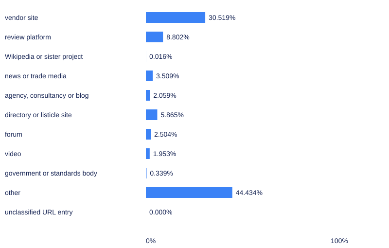

# Who appears in the sources of B2B software answers?

**Thirty-nine of 2,095 target answers had empty citation arrays: 1.9%, Wilson 95% interval 1.4% to 2.5% (Broadcastwell, 2026, Study 2).**

**Thirty-nine of 2,095 valid target answers** had empty citation arrays: **1.9%**, descriptive **95% Wilson interval 1.4% to 2.5%**. The remaining answers supplied the URL occurrences used in this study. Empty arrays were retained in the answer count rather than silently omitted. [Absence Index release 2026-09; answer-bases table](https://doi.org/10.5281/zenodo.22907695).

The question is descriptive: which publishers appear in the captured references, and how concentrated are those appearances? A reference does not prove that its page supports the answer, that its publisher is trustworthy or that a website feature caused selection. The study does not compare otherwise identical sources under a randomized change.

## Registration and analysis history

[OSF registration vczkt](https://doi.org/10.17605/OSF.IO/VCZKT) records the plan, with platform timestamp **30 October 2026, 01:32:03 UTC**. The published September archive existed before registration, and its aggregate release figures were already known. This is a registered secondary analysis of that archive, not a preregistered collection of previously unseen answers.

The plan originally required all three research-section registrations before analysis. A prospective timing amendment, recorded **30 October at 03:36:50 UTC**, permitted this completed registration to proceed while Study 1 awaited approval. No class rules, units or planned statistics changed in that amendment. The [deviation record](../../data/protocol-deviations.csv) preserves it. Study 1 subsequently became public; that does not retroactively erase the timing change.

Host classes were frozen at **04:41:53 UTC**, before class-share aggregation. A later audit found classification errors. We preserve the frozen primary result and show the corrected sensitivity separately below. There is no directional hypothesis, no significance test and no claim of a representative sample of all software buying.

## Which answers enter the analysis?

Inputs are the release’s answer JSONL, release JSON and control-question file, under version DOI **10.5281/zenodo.22907695**. Published checksums were matched before analysis. The archive has **2,250 observations**: **2,100 targets** and **150 controls**. Five excluded target observations remain in the exclusion audit, leaving **2,095 eligible targets** and all **150 controls**. [Release README, files and exclusion fields].

The primary target analysis contains **18,893 explicit citation-array entries**. Controls contribute **1,297**, making **20,190 eligible entries** in the combined archive. We neither infer extra references from prose nor treat an empty array as an unoptimized page. [Extraction CSV and answer-bases CSV].

| Engine | Valid target answers | Empty arrays / valid answers | Empty-array share and descriptive 95% Wilson interval | Citation entries |
|---|---:|---:|---|---:|
| ChatGPT | 420 | 0 / 420 | 0.0% (0.0% to 0.9%) | 1993 |
| Claude | 420 | 0 / 420 | 0.0% (0.0% to 0.9%) | 3975 |
| Google AI Mode | 420 | 29 / 420 | 6.9% (4.9% to 9.7%) | 1577 |
| Google AI Overviews | 415 | 10 / 415 | 2.4% (1.3% to 4.4%) | 3050 |
| Perplexity | 420 | 0 / 420 | 0.0% (0.0% to 0.9%) | 8298 |

Source: [answer-bases CSV](../../data/answer-citation-bases.csv), target scope and all categories. The controls are separate in that file: **12/150** control answers have empty arrays, **8.0%**, descriptive **95% Wilson interval 4.6% to 13.5%**. They are not mixed into the target table.

## A citation occurrence is not a unique document

Each original array entry retains its URL, engine, category, question, repeat, capture date and order. The primary count preserves occurrences. A separately computed sensitivity keeps no more than one exact URL per answer. This archive contains no within-answer exact duplicates, so that sensitivity reproduces the primary occurrence totals. No malformed or non-HTTP entries were found; the empty invalid-entry audit remains available. [Citation-occurrences and invalid-entry CSVs].

For host summaries, we lowercase the parsed hostname and remove a leading www. Other subdomains remain separate. Host concentration therefore differs from concentration by corporate owner. A citation to a review service’s editorial subdomain can be a different host from its product-review pages.

All Wilson intervals are two-sided and descriptive, conditional on these archived observations. References share questions, repeats and answers; they are not independent draws from all future queries. We report counts and bases even when the observed proportion is zero.

## How were publisher classes assigned?

The registered classes are checked vendor site, review platform, Wikipedia or sister project, news or trade media, agency/consultancy/blog, directory or listicle, forum, video, government or standards body, and other. Malformed entries would receive a separate unclassified audit label while remaining in the occurrence denominator.

Canonical vendor domains and documented subdomains use the release’s published record. Additional publisher-purpose evidence uses the publisher’s own accessible description. A list-shaped article does not automatically make its host a directory. A software feature for collecting reviews does not automatically make the vendor a review platform. Unknown, blocked or conflicting evidence remains other, with an ambiguity flag.

Purpose descriptions are evidence of what a publisher says it does, not independent verification of every claim on the site. The public host table provides the evidence URL, rationale, verification date and ambiguity for each host. It omits copied marketing excerpts. Primary response hashes document the collected source evidence without publishing raw HTML.

The vendor inventory is conservative. It includes the release’s checked vendors and documented additional category vendors; it does not establish a complete census of every vendor on the web. In particular, other is not equivalent to nonvendor.

## What did the frozen primary classification produce?



| Primary class | Citation entries / 18,893 | Share and descriptive 95% Wilson interval |
|---|---:|---|
| vendor site | 5,766 / 18,893 | 30.5% (29.9% to 31.2%) |
| review platform | 1,663 / 18,893 | 8.8% (8.4% to 9.2%) |
| Wikipedia or sister project | 3 / 18,893 | 0.016% (0.005% to 0.047%) |
| news or trade media | 663 / 18,893 | 3.5% (3.3% to 3.8%) |
| agency, consultancy or blog | 389 / 18,893 | 2.1% (1.9% to 2.3%) |
| directory or listicle site | 1,108 / 18,893 | 5.9% (5.5% to 6.2%) |
| forum | 473 / 18,893 | 2.5% (2.3% to 2.7%) |
| video | 369 / 18,893 | 2.0% (1.8% to 2.2%) |
| government or standards body | 64 / 18,893 | 0.3% (0.3% to 0.4%) |
| other | 8,395 / 18,893 | 44.4% (43.7% to 45.1%) |
| unclassified URL entry | 0 / 18,893 | 0.000% (0.000% to 0.020%) |


Source: [primary class-share CSV](../../data/citation-class-shares.csv), all-array-entries variant, target scope, all engines and categories. The download includes **each engine, each category and their joint strata**, with counts, bases and intervals, plus separate control and combined summaries. Other is the largest class, which substantially limits any claim about the complete source mix.

## What changed after the publisher-purpose audit?

The post-audit table changes five host roles: SourceForge, SoftwareReviews and Crozdesk move from directory to review platform; learn.g2.com moves from review platform to agency/consultancy/blog; solutions.trustradius.com moves from review platform to other. Multifunctional roles retain ambiguity flags. Eight additional directory/review descriptions receive ambiguity flags without a primary-role change. [Dated host-class correction CSV].

In that sensitivity, review-platform entries are **1,706/18,893**, **9.0%**, descriptive **95% Wilson interval 8.6% to 9.4%**, compared with the frozen **1,663/18,893**, **8.8%**, interval **8.4% to 9.2%**. The underlying citation entries do not change. [Post-audit shares](../../data/citation-class-shares-post-audit.csv).

Both classification versions also provide an ambiguity sensitivity that assigns flagged hosts to other. The primary and corrected results answer slightly different classification questions; neither warrants a universal trust hierarchy. Corrections after aggregation are explicitly exploratory, as required by the registration.

## How concentrated are the hosts?

The target record contains **1,896 distinct normalized hosts**. Its leading ten supply **3,192/18,893 entries**, **16.9%**, descriptive **95% Wilson interval 16.4% to 17.4%**. The highest-frequency ceiling of one percent is **19 hosts**, supplying **4,107/18,893**, **21.7%**, interval **21.2% to 22.3%**. Host-count ties are broken alphabetically. [Concentration CSV, target/all/all rows].

The [top-twenty table](../../data/top-twenty-hosts.csv) reports overall and engine-specific hosts with counts and shares. G2’s exact host is the overall leading host, with **580/18,893**, **3.1%**, interval **2.8% to 3.3%**. These are citation occurrences, not clicks, unique users or the portion of answers whose reasoning depended on that host. The [source-choice insight](../../insights/who-the-engines-trust/) discusses the engine-specific concentration table.

## Naming a vendor is different from citing its own site

Using the September matching definition and its accompanying public dictionary projection, we reproduced all **286 vendor records** across **42,792 eligible vendor-answer pairs**. Every named count, qualifying own-domain cited count and valid base reconciles with the deposited release. Plain-word names retain the published qualifier and boundary rules rather than accepting every substring.

Of **8,085 named pairs**, **2,608** have a qualifying own-domain citation: **32.3%**, descriptive **95% Wilson interval 31.2% to 33.3%**. Separately, **5,477/42,792 eligible pairs** are named without an own-domain citation: **12.8%**, interval **12.5% to 13.1%**. Those are deliberately different denominators. A third-party review reference does not count as the vendor’s own source. [Vendor-pair summary and reconciliation CSVs].

You can inspect the engine and category breakdowns in the downloads. The result does not mean the remaining named pairs lacked every source, or that a missing own-domain link caused a commercial disadvantage. It records what the saved answer said and cited under the published matching definition.

## Can another reader reproduce the tables?

The release deposit supplies the immutable answers and question files. The [public reproduction package](../../data/study2-reproduction.txt) supplies the matching function and a field-limited dictionary CSV. [Download the extraction](../../data/citation-occurrences.csv), [answer audit](../../data/answer-citation-audit.csv), [exclusions](../../data/excluded-answers.csv), [host classes](../../data/host-classes.csv), [pair observations](../../data/vendor-pairs.csv) and [pair summaries](../../data/vendor-pair-summary.csv). The [file manifest](../../data/study2-file-manifest.csv) records hashes and roles.

The public analysis accepts explicit input paths and an expected classification-file hash. The public host CSV is a projection of the frozen table with copied publisher prose removed; class and ambiguity values are identical. Its hash differs from the original frozen evidence file, and the manifest preserves both identities. [Citation analysis](../../data/analyze_citations.py); [pair reproduction](../../data/reproduce_vendor_pairs.mjs).

The main unresolved issue is classification coverage. More primary publisher evidence could resolve some other entries, while changed sites could make today’s labels less suitable for the September citation dates. The URL archive preserves the observation; a later fetch does not recover the page exactly as it existed when the answer was captured.

## What our own data shows

This study reanalyses [release 2026-09](https://doi.org/10.5281/zenodo.22907695), following the [registered plan](https://doi.org/10.17605/OSF.IO/VCZKT) with disclosed timing and classification deviations. It measures **20,190 eligible citation entries**, including controls, and **18,893 target entries**. Complete class, engine, category, concentration and vendor-pair outputs are linked above. The source-purpose judgments are contestable; counts do not measure trust or a causal ranking mechanism.

## Sources

- Broadcastwell. (2026). Absence Index, release 2026-09 [Data set]. Zenodo. Release JSON, answer JSONL and README. https://doi.org/10.5281/zenodo.22907695 Verified 30 October 2026.
- Broadcastwell. (2026). Who do AI engines cite for B2B software questions? [Registration]. OSF. Registered 30 October 2026, 01:32:03 UTC. https://doi.org/10.17605/OSF.IO/VCZKT Verified 30 October 2026.
- Broadcastwell. (2026). September matching definition and dictionary projection [Study instruments]. https://docs.broadcastwell.com/research/data/study2-reproduction.txt . The public package supplies the required function and dictionary fields. Verified 30 October 2026.

## Cite this page

Broadcastwell research team. (2026, October 30). *Who appears in the sources of B2B software answers?*. Broadcastwell. https://docs.broadcastwell.com/research/studies/who-ai-engines-cite/ Published 30 October 2026; updated 30 October 2026.

```bibtex
@online{broadcastwell2026research44,
  author = {{Broadcastwell research team}},
  title = {Who appears in the sources of B2B software answers?},
  year = {2026},
  date = {2026-10-30},
  url = {https://docs.broadcastwell.com/research/studies/who-ai-engines-cite/},
  urldate = {2026-10-30},
  note = {Published 2026-10-30; updated 2026-10-30}
}
```

Prepared by the Broadcastwell research team. Lead: Ananya Rao, AI engineer.

Sources checked 30 October 2026. Independent check: pending. This page has not been peer reviewed.

Last updated: 30 October 2026. Next review: 30 January 2027.

## Continue

- [Run a free visibility check](https://audit.broadcastwell.com/).
- [Read the measurement chapter](https://docs.broadcastwell.com/measurement-noise/).
